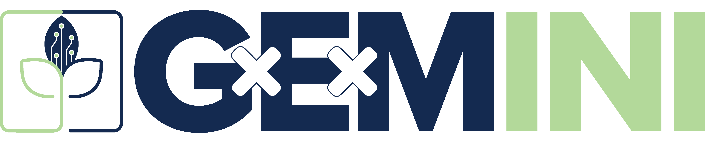
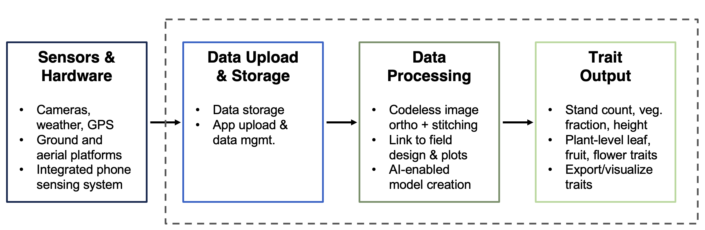

# 🌱 GxExMINI Phenotyping App



---

## 🔗 Overview

**GxExMINI** (GEMI for short) is a high-throughput phenotyping platform designed to accelerate the development of nutritious, stress-resistant staple crops. The platform includes:

- **Desktop Application:** Built with [Tauri v2](https://tauri.app) (Rust), React, and the [GEMINIbase](https://github.com/GEMINI-Breeding/GEMINIbase) (Litestar + Postgres + MinIO) backend.
- **Automated Processing Pipelines:** Support for both aerial and ground-based data.
- **Advanced Analytics:** Feature-rich interface for mapping, trait extraction, and data querying.

For more information about the project and our research, visit: [https://projectgemini.ucdavis.edu/](https://projectgemini.ucdavis.edu/)

---

## 📚 Resources

- 📝 [**Full Documentation & User Guides**](https://gemini-breeding.github.io/)  
- 📂 [**Example Data**](https://ucdavis.box.com/s/ts802xlcddyufixfjmeayxwiiz2mxrb9)

---

## ⚙️ Installation & Setup

### Local Development

Local development has two parts: the **backend**, which runs in Docker, and the **frontend**, which runs on your machine and talks to the backend. You can open the frontend in a web browser or in the Tauri desktop window.

For deeper background on the stack, see the **[Developer Guide](https://gemini-breeding.github.io/start_guide/developer_guide/)** in the official documentation.

#### Prerequisites

| Tool | Version | Needed for |
|------|---------|------------|
| Git | 2.46 or newer on Windows (see [Troubleshooting](#troubleshooting-local-development)) | Cloning the repo and the backend submodule |
| [Docker Desktop](https://www.docker.com/products/docker-desktop/) (or Docker Engine with Compose v2) | Current | Running the backend |
| [Node.js](https://nodejs.org) | 22 or newer | Running the frontend |
| [Rust](https://rustup.rs) (stable), plus the platform build tools listed in [`docs/BUILDING.md`](./docs/BUILDING.md) | 1.77 or newer | The desktop window only; not needed for the browser |

On Windows, run the commands below in **Git Bash**. The setup scripts are bash scripts.

#### 1. Clone the repo with its submodules

```bash
git clone --recurse-submodules https://github.com/GEMINI-Breeding/GEMINI-App.git
cd GEMINI-App
```

#### 2. Start the backend (one-time setup)

The backend is [GEMINIbase](https://github.com/GEMINI-Breeding/GEMINIbase), included as a git submodule at `backend/`. It runs as a Docker Compose stack: Postgres, MinIO, Redis, a Litestar REST API, TiTiler, NodeODM and the processing workers.

```bash
./scripts/setup-backend.sh     # fetches backend/ and creates its .env files
docker compose up -d --build   # builds the images and starts the stack
```

The first build downloads and builds several large images and can take 10 minutes or more. When it finishes, check that the API is up:

```bash
docker compose ps              # rest-api and logger should show "healthy"
curl http://localhost:7777/    # should respond with HTTP 200
```

#### 3. Install frontend dependencies (one-time setup)

```bash
cd frontend
npm install
```

#### 4. Run the frontend

Run **one** of the following from `frontend/`. Both serve the frontend on port 5173, so don't run them at the same time.

| Goal | Command | Result |
|------|---------|--------|
| Work in a web browser (fastest) | `npm run dev` | Open http://localhost:5173 |
| Work in the desktop window | `npm run tauri:dev` | Tauri starts the dev server itself, then opens the GEMI window. The first Rust build takes several minutes. |

In both modes, frontend changes reload automatically. In the desktop window, changes under `frontend/src-tauri/` trigger a Rust rebuild and restart the app.

Shortcut: `npm run dev:full` starts the backend containers, waits until they are healthy, and then runs `npm run dev`.

#### 5. Log in

A development admin account is created on first start. Its credentials are in `backend/gemini/pipeline/.env`:

```
Email:    admin@gemini.example.com     (GEMINI_FIRST_SUPERUSER_EMAIL)
Password: gemini-admin-dev             (GEMINI_FIRST_SUPERUSER_PASSWORD)
```

#### Day-to-day

| Task | Command (from the repo root) |
|------|------------------------------|
| Start the backend | `docker compose up -d` |
| Rebuild after pulling or after changing backend code or Dockerfiles | `docker compose up -d --build` |
| Develop the backend with live sync and automatic rebuilds | `docker compose watch` (configured in `docker-compose.override.yaml`) |
| Stop the backend | `docker compose down` |
| View a service's logs | `docker compose logs -f <service>` (for example `rest-api` or `storage-init`) |

`npm run dev` warns you when the worker images are older than the backend source. When that happens, rebuild with `--build`.

#### Ports

| Service | Port |
|---------|------|
| Frontend dev server (Vite) | 5173 |
| REST API | 7777 (the dev server forwards `/api/*` requests to it) |
| TiTiler | 8091 |
| NodeODM | 13000 |
| MinIO | 9000 (API), 9001 (console) |
| Postgres | 5432 |
| Redis | 6379 |

GEMINIbase's reference UI (`geminibase-ui`) is off by default. Start it with `docker compose --profile geminibase-ui up -d`.

#### Troubleshooting local development

- **`$'\r': command not found`, `can't cd to ...`, or `Malformed input to a URL function` during `docker compose` builds.** Your checkout has Windows (CRLF) line endings, which break the shell scripts that are copied into the Linux containers. Fix the line endings in the root repo and the `backend` submodule, then rebuild. The commands below discard changes to tracked files, so commit or stash any changes first:
  ```bash
  git config core.autocrlf false
  git -C backend config core.autocrlf false
  for r in . backend; do git -C "$r" rm -rq --cached . && git -C "$r" reset -q --hard; done
  docker compose up -d --build
  ```
  To avoid this in future clones, run `git config --global core.autocrlf input` before cloning.
- **`'..' is not recognized as an internal or external command` from `npm run dev` on Windows.** npm is running scripts with `cmd.exe`, which can't run the bash script that `npm run dev` runs first. Point npm at Git Bash:
  ```bash
  npm config set script-shell "C:\\Program Files\\Git\\bin\\bash.exe"
  ```
- **`detected dubious ownership`, or `not a git repository` during `setup-backend.sh`.** This happens when the repo is on a drive that doesn't record file owners, such as an exFAT or FAT32 external drive. With Git 2.46 or newer, mark the drive as trusted, then remove the partial clone and run the script again:
  ```bash
  git config --global --add safe.directory 'G:/*'   # use your drive letter
  rm -rf backend .git/modules/backend
  ./scripts/setup-backend.sh
  ```
- **The desktop app exits with `STATUS_IN_PAGE_ERROR` (0xc0000006).** Windows could not read the app's executable from disk. This usually means the repo is on a USB drive that disconnected or went to sleep. Keep the Rust build output on an internal drive, for example `export CARGO_TARGET_DIR="$HOME/.cargo-target/gemi"` before running `npm run tauri:dev`.
- **Port 5173 is already in use.** A dev server is already running, from `npm run dev` or from an earlier `tauri:dev`. Stop it before starting another one.

### Building for Production
See [`docs/BUILDING.md`](./docs/BUILDING.md) for platform-specific build instructions (Linux, macOS, Windows).

> **Note on Windows:** **Docker Desktop** is required for certain data processing features in the application. Ensure it is running when performing these tasks.

---

### AI Agent, Models and HPC

The app's home page is an **agent**: tell it what to do (upload data, check
jobs, mark plots, stitch) and it works the app through the same API you do.
The same agent runs from a terminal, and its tools plug into clients such as
Claude Code. Full guide: [agent/SETUP.md](agent/SETUP.md).

Quick start, local stack:

```bash
pip install pillow numpy
cd agent
# agent/.env: GEMI_API, GEMI_EMAIL, GEMI_PASSWORD   — agent/config.json: the model (below)
python -m gemi_agent serve          # then open the app's home page
python -m gemi_agent chat           # or talk to it in the terminal
```

**Choosing a model.** Any OpenAI-compatible chat endpoint works; set
`base_url`, `model` and (if needed) `api_key` in `agent/config.json` or on
the home page (gear icon).

| | Example `base_url` | Good for |
|---|---|---|
| Hosted API (Anthropic, OpenAI, OpenRouter, …) | `https://api.anthropic.com/v1` | quickest start; best at long procedures; data goes to the provider |
| Local on your cluster (vLLM, e.g. Gemma 4) | from `gemi-hpc llm tunnel` | data stays in-house; needs a GPU node |
| Local on this computer (Ollama, LM Studio) | `http://localhost:11434/v1` | small tasks; needs a capable GPU |

Marking plots needs a model that accepts images.

**Using your HPC cluster for compute.** With Slurm and Apptainer the whole
stack — database, storage, workers and optionally the model — runs as
cluster jobs, driven from this computer:

```bash
# once: copy hpc/clusters/launch.conf.example to hpc/clusters/<yours>/launch.conf, edit it, then
bash hpc/gemi-hpc sync && bash hpc/gemi-hpc pull && bash hpc/gemi-hpc llm pull
# each session
bash hpc/gemi-hpc up                    # core services
bash hpc/gemi-hpc worker amiga stitch   # workers for the steps you will run
bash hpc/gemi-hpc llm up                # optional local model on a GPU
bash hpc/gemi-hpc app                   # tunnels + agent + app; prints the URL and login
bash hpc/gemi-hpc down                  # when done
```

Procedures the agent follows are plain Markdown in
[agent/skills/](agent/skills/) — one per stage (upload, ground pipeline,
plot marking, stitching, aerial pipeline, inference, monitoring, HPC). Edit
them to change how the agent works; any model can read them.

Planned: a first-run setup on the home page that connects a cluster, cloud
GPU or this computer and picks a model with the agent's help.

#### Install the app, then drive it from a coding agent's terminal

The installed app contains `gemi-agent`, one executable with every tool the
in-app agent has. A coding agent (Claude Code, Codex, Gemini CLI, any MCP
client) can use it directly, with its own model: no model has to be set up
in the app at all.

1. Install GEMI for your system from the
   [releases page](https://github.com/GEMINI-Breeding/GEMINI-App/releases)
   and open it once (macOS: the build is not notarized yet; allow it under
   System Settings → Privacy & Security → Open Anyway).
2. Find the executable:

   | System | Path |
   |---|---|
   | macOS | `/Applications/GEMI.app/Contents/MacOS/gemi-agent` |
   | Windows | `gemi-agent.exe` in the folder GEMI was installed to |
   | Linux (.deb) | `/usr/bin/gemi-agent` |

3. Register it as an MCP server. Claude Code:

   ```bash
   claude mcp add gemi -- /Applications/GEMI.app/Contents/MacOS/gemi-agent mcp
   ```

   Other clients: a stdio MCP server whose command is that path and whose
   one argument is `mcp`.
4. Ask the coding agent in plain words, for example: *"Use the gemi tools.
   Read the skill connect-hpc and set GEMI up on my cluster; my login is
   `ssh you@login.cluster.edu`."* Then: *"upload the photos in
   ~/flights/2026-08-21 as a drone flight for Davis / Sorghum and continue
   that run."*

The terminal and the app share one set of settings and state (the app's data
folder), so what the coding agent sets up appears in the app, and the other
way round. The same executable also works by hand:
`gemi-agent tools`, `gemi-agent status`, `gemi-agent processes`,
`gemi-agent chat "what is running?"` (that last one needs a model set in the
app).

Working from a source checkout instead: see
[agent/SETUP.md](agent/SETUP.md), "Quick start: a terminal". There the skills
and the cluster guard for Claude Code come with the repository.

#### An open model without an agent

The home page's setup offers **Set up a free open model**: pick Gemma 4 or
another open model, and where it runs. On this computer GEMI uses
[Ollama](https://ollama.com) to download and serve it. On a cluster it looks
at the cluster over SSH, chooses a GPU queue, installs the model server and
the weights, starts it and connects. Each step shows its expected and actual
time.

#### Compute panel and cluster safety

The home page's **Compute** panel lists the core, each worker and the agent
model with its state, how many jobs wait for it, Start / Stop, and which
partition to run on (from the placements in the cluster's `launch.conf`).

Every action on the cluster goes through one script there,
`hpc/remote/gemi-gate`: a fixed menu confined to the GEMI directory, with job
size limits and a log of every call. Agents may read and run routine pipeline
work freely; starting or ending the session, changing its configuration and
deleting data ask first. Check a cluster with `bash hpc/gemi-hpc doctor`.
Details: [agent/SETUP.md](agent/SETUP.md), section 6.

## 📦 Key Dependencies

GEMI integrates several open-source tools and packages as core components of its processing pipelines:

### [OpenDroneMap (ODM)](https://opendronemap.org/)
Used in the **aerial pipeline** for photogrammetric reconstruction — processing drone imagery into georeferenced orthomosaics and digital elevation models (DEMs). GEMI orchestrates ODM as a sidecar process and consumes its outputs for downstream trait extraction.

### [AgRowStitch](https://github.com/GEMINI-Breeding/AgRowStitch)
Used in the **ground pipeline** for stitching rover-captured (Amiga) row images into plot-level mosaics. AgRowStitch runs inside the GEMINIbase stitch worker when a `RUN_STITCH` job is submitted.

> Uyehara, I. K. et al. *AgRowStitch: A High-fidelity Image Stitching Pipeline for Ground-based Agricultural Images* arXiv, 2025. [arxiv.org/pdf/2503.21990](https://arxiv.org/pdf/2503.21990)

### [farm-ng Amiga SDK](https://github.com/farm-ng/farm-ng-amiga)
Used for decoding and extracting data from **farm-ng Amiga** ground rover logs (`.bin` files). The SDK provides the tools needed to parse platform telemetry and camera data recorded during field operations.

---

## 🔍 Pipeline Overview



- **File Management System** – Effortlessly organize, verify, and sync metadata for raw and processed data.
- **Aerial Pipeline** – Full workflow for drone imagery, from GPS sync and GCP alignment to orthomosaic generation and trait extraction.
- **Ground Pipeline** – Purpose-built pipeline for rover-based (Amiga) data, featuring custom plot marking, image stitching, and inference model execution.
- **Linked Data Visualization** – Visualize data with direct links to field design layouts via the **Analyze** tab.
- **AI-Enabled Analysis** – Integration with RoboFlow for computer vision tasks (object detection and segmentation).
- **Trait Extraction & Export** – Compute and export key plant traits (e.g., height, vegetation fraction) for downstream research.
