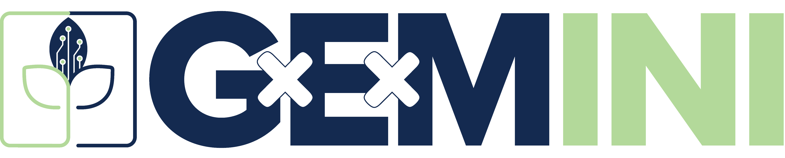
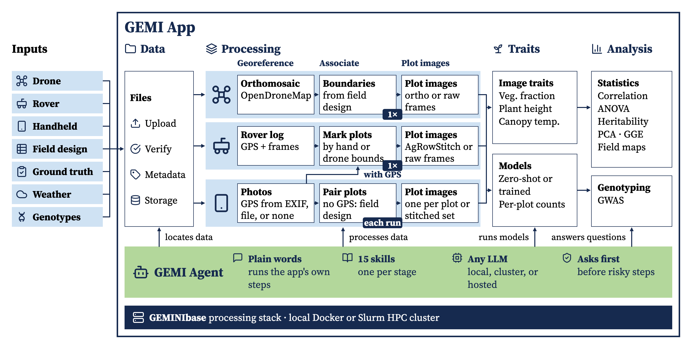

# 🌱 GxExMINI Phenotyping App

**GxExMINI** (GEMI for short) turns drone flights, rover runs and handheld photos into per-plot images and trait measurements, and analyses them alongside field designs and genotype data. It is a desktop app for Windows, macOS and Linux, with an optional AI agent that can do the processing for you on request.

More about the project: [projectgemini.ucdavis.edu](https://projectgemini.ucdavis.edu/) · [Documentation and user guides](https://gemini-breeding.github.io/) · [Example data](https://ucdavis.box.com/s/ts802xlcddyufixfjmeayxwiiz2mxrb9)

## Get started

1. Download the installer from the [releases page](https://github.com/GEMINI-Breeding/GEMINI-App/releases) and open GEMI.
2. Choose where the processing runs: **this computer** (GEMI installs Docker Desktop for you) or **a Slurm cluster** you reach with an SSH key (GEMI sets it up from your computer).
3. Choose whether to work with the agent or by hand. Every step can be done in the app without a language model.

## Read more

| Topic | |
|---|---|
| Installing, system needs, the first-run walkthrough | [docs/INSTALL.md](docs/INSTALL.md) |
| The app's pages, ground and aerial pipelines, models | [docs/USING.md](docs/USING.md) · [App Guide](https://gemini-breeding.github.io/app_guide/) |
| The agent: choosing a model, using GEMI from a coding agent | [docs/AGENT.md](docs/AGENT.md) |
| Running on a cluster, and from a second computer | [docs/CLUSTERS.md](docs/CLUSTERS.md) |
| Running from source, building installers | [docs/RUNNING_FROM_SOURCE.md](docs/RUNNING_FROM_SOURCE.md) · [docs/BUILDING.md](docs/BUILDING.md) |
| Reporting a bug or suggesting a change | [GitHub issues](https://github.com/GEMINI-Breeding/GEMINI-App/issues), or ask your coding agent ([AGENTS.md](AGENTS.md)) |

## Key dependencies

- **[GEMINIbase](https://github.com/GEMINI-Breeding/GEMINIbase)**: the processing stack (Litestar API, Postgres, MinIO, Redis, TiTiler and the workers), included at `backend/`.
- **[OpenDroneMap](https://opendronemap.org/)**: drone images to georeferenced orthomosaics and elevation models (aerial pipeline).
- **[AgRowStitch](https://github.com/GEMINI-Breeding/AgRowStitch)**: rover row images to plot mosaics (ground pipeline).
  Uyehara, I. K., Yun, H., Rizzo, K. T., Ranario, E., & Earles, M. (2026). AgRowStitch: A leaf-scale image stitching pipeline for ground-based agricultural images. *Applied Engineering in Agriculture*, 42(3), 307–317. [doi.org/10.13031/aea.16650](https://doi.org/10.13031/aea.16650)
- **[farm-ng Amiga SDK](https://github.com/farm-ng/farm-ng-amiga)**: reads Amiga rover logs (`.bin`).
- **[Tauri](https://tauri.app)** and React: the desktop app.
